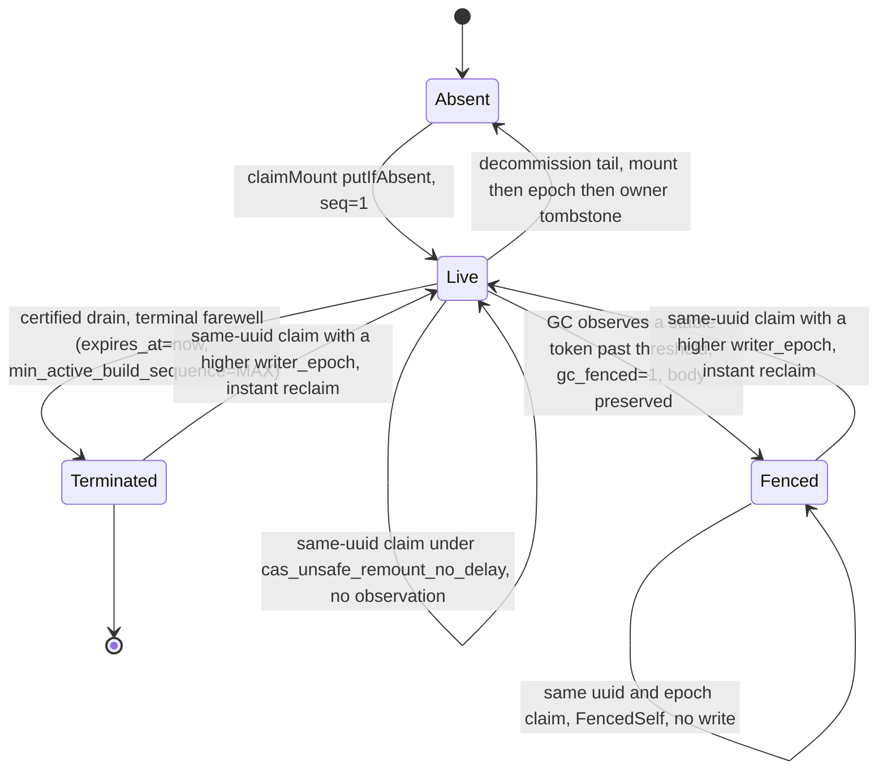
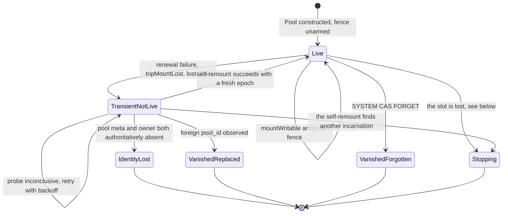

Page 4 of 4 in the CAS architecture set. Covers server identity, the mount lease that fences
writers, and the server-scoped control-plane objects. No external coordinator is involved: there
is no ZooKeeper/Keeper client anywhere in this protocol — `MountLeaseRenewer` is a local lease
*renewer*, not a Keeper client.

## `cas_server_root_id` — the identity {#server-root-id}

Every content-addressed disk must be configured with an explicit `cas_server_root_id`. It is
validated and immutable, and deliberately **not** derived from `ServerUUID` — two replicas can
otherwise regenerate the same `ServerUUID` from a wiped local state directory, which must not
silently steal an existing identity.

Validation (`validateServerRootId`, `Pool/CasServerRoot.h`) is fail-closed `BAD_ARGUMENTS`, no
sanitizing fallback: non-empty, at most 255 bytes, no empty/`.`/`..` path segment, no `_files` or
`_manifests` segment.

It roots four subtrees and owns catalog names at or below `<server_root_id>`:

| Subtree | Contents |
|---|---|
| `gc/server-roots/<server_root_id>/` | owner, epoch, mount — the three control-plane objects below |
| `roots/<server_root_id>/` | loose mountpoint objects, no namespace/catalog association |
| `cas/manifests/<server_root_id>/` | part manifests |
| `staging/<server_root_id>/` | S3-staging debris, outside every GC `LIST`, reclaimed only by this server's next mount |

`blobs/` is **not** under the `server_root_id` — content is pool-global, which is what makes cross-server
dedup work. Ref/namespace keys are also deliberately opaque and do not embed the `server_root_id`.

Each replica sharing a backend endpoint must use a distinct `cas_server_root_id`; omitting the setting
is a startup error.

## The owner claim {#owner-claim}

`claimOwnerOrThrow` binds `server_root_id` ↔ `server_uuid` **permanently**. The owner object is never deleted
and never reassigned — decommission only tombstones it in place.

| Observed at `gc/server-roots/<server_root_id>/owner` | Action |
|---|---|
| present, same `server_uuid`, not tombstoned | proceed |
| present, `retired_at_ms` set | `CORRUPTED_DATA` — explicitly decommissioned, refuses to resume |
| present, different `server_uuid` | `CORRUPTED_DATA` — names the regenerated-uuid-file cause |
| absent, subtree provably empty | `putIfAbsent` the owner (claim) |
| absent, subtree non-empty | `CORRUPTED_DATA` — identity lost over existing data |
| lost the `putIfAbsent` race | re-read; equal uuid proceeds, else `CORRUPTED_DATA` |

"Provably empty" requires both an authoritative decoded catalog naming no life owned by `server_root_id` and
a 1-key `LIST` probe finding nothing under `cas/manifests/<server_root_id>/` or `roots/<server_root_id>/`.

Two failure modes this closes:

- A **second server with a different `server_uuid`** is refused at this gate and can never take
  over, regardless of lease expiry.
- A **same-uuid live twin** (two processes sharing one uuid file and `server_root_id`) is caught separately, by
  the mount claim's token-stability observation, and aborts with an operator-facing message rather
  than corrupting the pool — this is the default behavior, with `cas_unsafe_remount_no_delay` off.
  With it on, a same-uuid claim over such a slot reclaims at once instead of observing (see
  `cas_unsafe_remount_no_delay` in the configuration reference).

## The mount lease {#mount-lease}

One object, `gc/server-roots/<server_root_id>/mount`, carries **both** the liveness lease and the build
watermark — there is no separate watermark object. `MountLease` fields: `server_uuid`,
`writer_epoch`, `write_attempt_id`, `hostname`, `pid`, `started_at_ms`, renewal `seq`,
`expires_at_ms`, `min_active_build_sequence` (the build-watermark floor), and `gc_fenced`.

- **Logical renewal identity.** Each holder-originated body has a fresh nonzero
  `write_attempt_id`. One logical renewal fixes one immutable `(key, bytes, expected token,
  write_attempt_id)` tuple before I/O. Every physical retry repeats it byte-for-byte; a later GC
  fence preserves the observed ID, while reclaim and successor bodies mint new IDs.
- **Resolve before retry.** A transient or ambiguous conditional `PUT` is followed by one exact
  `GET`, except that an attempt whose transport error names a failed connection is reissued first
  after a flat pause and settled by the reissue's own answer (a 2xx) or by the exact `GET` that
  follows its `412`. The renewer adopts the result only when the complete body, including `write_attempt_id`,
  equals its immutable request. If the predecessor token is still current, another identical `PUT`
  follows after a pause. A same-pair twin, GC-fenced body, successor, foreign holder, or absent
  body is never treated as this renewal.
- **Deadline from the start.** Renewal uses `CLOCK_BOOTTIME`, not `CLOCK_MONOTONIC`, so a VM resumed
  from suspend correctly observes itself expired. A confirmed renewal or claim sets the deadline to
  its own start plus the lease; a retry, `GET`, response timestamp, or wall-clock step never moves
  it. The background renewal has no deadline of its own: it retries one body every 0.8–1.2 s (measured from
  the start of the previous attempt) until the store answers about the slot, or until a stop, a
  remount park request, a lost fence or a pool leaving `Live` ends it. A
  refusal (`AccessDenied`, `MalformedXML`, …) sends the same body again, one renewal period later for
  a credential refusal. The startup re-anchor and the remount re-anchor stay bounded by the last
  confirmed lease minus the safety margin.
- **Cadence.** The runtime normally starts a logical renewal every `cas_mount_renew_period_ms` (default
  10 s), with TTL `cas_mount_lease_ttl_ms` (default 30 s, TTL/3 renewal ratio). The next beat is anchored
  at the committed body's pre-I/O BOOTTIME start. A slow recovery therefore causes an immediate
  catch-up beat when the nominal cadence has elapsed; it does not wait a fresh full period after the
  response.
- **Per-write recheck.** Every durable write or delete captures the fence generation at admission
  and rechecks it immediately before the object-store call and on every conditional retry. Reads
  are not gated.
- **Request-budget admission.** `refAppendFenceOk` refuses to *start* a ref-log attempt unless
  `2 × envelope + safety_margin` fits inside the remaining lease (a write and its settlement read),
  rejecting with `BAD_ARGUMENTS` at request-admission time rather than mid-flight.

**Losing the lease is neither read-only mode nor a process abort.** `MountLeaseRenewer` is a
synchronous durable-slot state machine. A committed result advances its token, sequence, confirmed
BOOTTIME deadline, and cadence anchor. A deterministic failure, a confirmed conflict, or, for a
bounded renewal, ambiguity left at its deadline moves it to `RenewalTerminal`; it cannot mint another
body or publish a clean farewell. Owner cancellation before any request is the only
`NotAttempted` result and leaves clean release possible. Cancellation after a request was sent is
terminal because that request may still land.

**An expired lease is a pause.** While the store does not answer, writes stop being admitted once the
remaining lease cannot cover them, and the lease expires at its deadline. `system.cas_mounts` then
shows `lifecycle = 'paused'` and `lifecycle_reason = 'lease_expired'`, and the server logs one
`WARNING`: `CAS mount lease of '<server_root_id>' expired <N> ms ago under writer_epoch <E>`. Nothing
is remounted. The first confirmed renewal whose start plus the lease is still ahead resumes writes
under the same `writer_epoch`; a renewal confirmed later than that leaves writes paused, and the next
one starts at once.

After the renewer call returns, `CasMountRuntime` consumes the result. A terminal result trips the
local fence (latches `lost`, bumps the fence generation, moves the in-process runtime to
`TransientNotLive`) and latches one self-remount generation. A confirmed foreign/successor or
same-pair conflict remains a typed fail-closed error; it is never adopted. A real fence still costs
only an epoch: recovery reclaims with a fresh one, bounded at three whole-chain attempts. This is the
general CAS posture: doubt about the source fails closed, while transport ambiguity is retried until a
definitive answer and writes are admitted only inside the last confirmed lease.

GC's own view of a dead server is symmetric and clock-skew-immune: a slot becomes fence-eligible
only after the leader observes the *same* renewal token hold stable, on its own monotonic clock,
for `TTL + floor(TTL/20) + period` — close to, but not identical to, the threshold a re-mounting
server uses to wait out a predecessor, which observes `TTL + floor(TTL/20) + max(1,
floor(period/2))`. Both thresholds are evaluated purely on the observer's own clock and its own
configured `TTL`/`period`; nothing about the writer's timing travels on the wire. The stamped
`expires_at_ms` never participates in either decision — it is a writer-stamped diagnostic used by
`system.cas_mounts` and by the non-authoritative decommission epoch-recovery precheck, never an
authorization; local fencing is derived instead from the confirmed request's pre-I/O `BOOTTIME`
anchor plus the TTL, and wall-clock `now` stays audit-only.

Every server sharing a pool must therefore run the identical `cas_mount_lease_ttl_ms` and
`cas_mount_renew_period_ms`: a member or GC leader configured with a shorter threshold than its
peers can fence out a healthy peer whose token-update gap merely exceeds that shorter threshold —
a peer renewing frequently stays live, one that missed a renewal does not. Change these values only
with every member of the pool stopped; a graceful restart removes only that member's own startup
observation and does not make mixed thresholds safe. With the defaults (TTL 30 s, period 10 s,
margin 2 s), `TTL − margin − period − 2 × envelope = 4 s` is the scheduling-lateness budget before
the first renewal attempt of a period can begin, where `envelope = attempt_timeout + 2 × cap` and
`cap` is `attempt_timeout` when the disk's `connect_timeout_ms` is `0`, else
`min(connect_timeout_ms, attempt_timeout)` (7 s with defaults).

## The two monotone counters {#counters}

| Counter | Storage | Scope | Protects against |
|---|---|---|---|
| `writer_epoch` | durable, `gc/server-roots/<server_root_id>/epoch` (`ServerEpoch::next_writer_epoch`, CAS-bumped by `allocateWriterEpoch`) | across crashes and restarts | a same-`(uuid, epoch)` twin: a present mount under a normal claim attempt is `CORRUPTED_DATA` |
| `build_seq` | in-memory only, `CasMountRuntime::next_build_seq`, reset to 1 on every process start | one process incarnation | orders builds *within* an epoch; combined with `writer_epoch` it gives GC a total order |

The absent-epoch branch of `allocateWriterEpoch` is deliberately paranoid: absent with a
non-empty subtree is `CORRUPTED_DATA` (reset hazard); absent with an empty subtree decides by an
authoritative probe, never by plain-`get` absence, because a transport fault must not be flattened
into "not found".

Global build ordering is the **pair** `(writer_epoch, build_seq)` compared lexicographically — the
exact comparison GC uses for eligibility. The durable authority for both is the mount object
itself: no mount means no deletion authority means nothing is swept. `min_active_build_sequence`, the oldest
in-flight `build_seq`, rides in the same mount object as the watermark floor; `UINT64_MAX` in
`min_active_build_sequence` is the farewell/retired sentinel, not a real build.

## Mount claim outcomes {#claim-outcomes}

The implementation does not expose a single named durable-slot enum; `claimMount` instead returns
a `MountClaimResult::Kind` together with a `MountPriorState` describing which certificate of death
(if any) justified a reclaim:

| `Kind` | Meaning |
|---|---|
| `Claimed` | fresh claim (absent slot), or a certified reclaim of an older `writer_epoch` |
| `LiveDoubleStart` | same `server_uuid` with an older `writer_epoch` and no certificate of death yet — a live twin, wait it out; or the same `(uuid, epoch)` already in the slot — two starts got one epoch, refused at once |
| `ForeignOwner` | different `server_uuid` — refused unconditionally |
| `FencedSelf` | same `(uuid, epoch)`, but `gc_fenced` — terminal for *this* epoch; the caller must mint a fresh one |

A claim never installs a `writer_epoch` at or below the one in the slot. When the slot holds a newer
`writer_epoch` of the same `server_uuid`, the claim fails with `ABORTED` and writes nothing: another
start or a decommission of this `server_root_id` allocated after this one.

| `MountPriorState` | Certificate that justified the reclaim |
|---|---|
| `None` | no reclaim needed (fresh claim) |
| `Clean` | the predecessor's own graceful farewell (`min_active_build_sequence == UINT64_MAX`) |
| `Fenced` | GC's own threshold-gated fence-out (`gc_fenced`) |
| `UncleanObserved` | this claimant's own token-stability observation held for the full `TTL + drift` window |
| `UncleanUnsafe` | the operator's explicit `cas_unsafe_remount_no_delay` authorization carried the slot's exact token — not a certificate of death |

## Behavioral mount-slot model {#mount-state-machines}

Two coupled state pictures. Neither is a literal source enum — the durable slot is derived from
the claim outcomes above and is shown here as behavior, not as a type in the code:

The in-process `PoolLifecycle` runtime, by contrast, is a literal enum (`CasMountRuntime.h`):

`IdentityLost`, `VanishedReplaced`, `VanishedForgotten` and `Stopping` are terminal and absorbing, with
deliberately no auto-revive — an identity disappearing under a live mount is an operator-level event.
The remount thread self-exits in all four. The GC scheduler self-exits in the first three; on
`Stopping` it keeps running until the server shuts down or the disk is torn down.

## Mount, unmount, crash {#mount-lifecycle}

**Writable open** runs in a strict order: bootstrap-residual proof, capability probe under a
random per-mount prefix, pool-meta create-or-validate, `validateServerRootId`, owner claim,
`allocateWriterEpoch`, mount claim (one conditional write; the renewer starts from its confirmed
body), arm the fence, then create and release the runtime-owned renewal and remount workers before
the writable pool becomes externally visible. The lease runs from the claim's start; if too little
is left to arm the fence, one synchronous renewal re-anchors it. That renewal needs two attempt
envelopes before the lease-safe deadline, or the start fails. Without the background renewal worker
the fence asks for the same two envelopes, so a start whose claim needs that renewal fails unless
exactly two envelopes remain.
Failure to construct either worker joins the partial pair, closes the fence, and fails the writable
open. No incident path constructs a thread.

The renewal and remount workers are separate and long-lived under one stable `CasMountRuntime`.
`scheduleRemount` increments a requested-generation latch and wakes the persistent remount worker,
including while an older generation is active. Before renewer replacement, remount requests
`ParkRequested` and waits for the renewal driver to report `Parked`, which proves that no renewer call
is in flight. A successful remount handles only its snapshotted generation; a newer request is
processed before renewal resumes.

**Clean unmount:** stop and join both persistent workers, drain the ref lanes and wait for snapshot
publishes, then `release` on an `Active` renewer writes the farewell (`expires_at_ms` expired,
`min_active_build_sequence = UINT64_MAX`), so a successor reclaims at once. The write is conditional on
this mount's token, so it is written after the lease expired too; a moved slot refuses it. No farewell is
written while a ref lane is writing or wedged, a publish is in flight, a cleanup duty is undrained, or the
last renewal ended without a confirmed lease. The line
`CAS store shutdown without the clean-release marker: <causes>` says which. A `stopping` disk writes none;
`SYSTEM CAS FORGET` writes it under these rules before `closed`.

**Crash:** no farewell; the renewal token freezes. Recovery is either the same server restarting
and waiting out the token-stability observation, or the GC leader fencing the slot first, after
which any reclaim is instant.

**Permanent removal** of a dead replica (`Cas::decommissionPoolMember`, driven by
`SYSTEM CAS DROP POOL MEMBER '<server_root_id>' FROM DISK '<disk>'`) claims the victim's mount slot
as an administrative writer with a no-wait policy (refuses immediately if the member is alive),
drops every ref-bearing namespace, sweeps manifest debris before the slot (deleting the mount
removes the watermark authority), drains staging and roots, then — only with zero warnings —
retires in order: mount, epoch, a final liveness re-check, owner tombstone.

## When the mount slot is lost {#slot-lost}

A renewal whose conditional write is refused reads the slot. If the slot no longer holds a body of
this incarnation, the mount ends for good: the write fence closes first, then the server is asked to
stop, then one `ERROR` line on the `CasPool` logger says what was in the slot. The first end wins;
`system.cas_mounts` shows `lifecycle = 'stopping'` with the reason in `lifecycle_reason`.

| `lifecycle_reason` | What was found | What happens |
|---|---|---|
| `slot_taken` | a body of another server, or of another `writer_epoch` of this server, or a copy of our own body under a token we did not write | graceful server stop |
| `slot_absent` | no slot, and a `LIST` of the key agrees with the `GET` | graceful server stop |
| `slot_corrupt` | bytes that do not decode, or a body of our own `(server_uuid, writer_epoch)` that this server did not write | graceful server stop |
| `ledger_fault` | a ref-log id this writer owns holds an object it did not write, or a ref lane contradicts itself | `LOG_FATAL`, the process ends at once without a shutdown |
| `local_defect` | the renewal machine itself failed (not the store, not the memory limit) | `LOG_FATAL`, the process ends at once without a shutdown |

- **Graceful stop** is `SIGTERM` to the own process: every CAS disk of the server stops with it. A
  stopping disk refuses new changes as retry-later and writes no farewell; its ref-lane drain sends no
  request, so a shutdown over a dead store does not wait on it.
- **The end without a shutdown** is for a broken process invariant: a shutdown writes the farewell and
  the checkpoints under an identity another process may hold.
- **Our own GC fence** (`gc_fenced` on the body this server wrote) is not a loss: the self-remount takes a
  fresh epoch as before. A self-remount that finds another server, a newer epoch of this server, or a
  body of the fenced pair that keeps changing stops the server too. A body of the fenced pair that does
  not change is reclaimed after the token-stability observation, as after a crash.
- **A `GET` 404 alone proves nothing**: a proxy or a misrouted request answers it as well. Absence counts
  only when a `LIST` of the key agrees; otherwise the background renewal reads again.
- **`SYSTEM CAS FORGET`** closes the disk and the server keeps running. A loss latched before FORGET
  finishes wins: the disk stays `stopping`.
- **Read-only mounts** have no renewer and never stop the server. **Decommission** fails its command
  and deletes nothing more. A writable mount opened without background workers (tools) closes the disk
  instead of stopping the process.
- **Restart policy:** the graceful stop is a `SIGTERM` shutdown, not a crash. If the server should come
  back on its own, configure the supervisor to restart it on any exit (systemd `Restart=always`).
- **`clickhouse-local`** installs no `SIGTERM` handler, so the stop ends it at once.
- **Not detected:** a byte-identical clone, a second process that writes exactly this server's bytes:
  the store cannot tell its write from ours.

## `system.cas_mounts` {#mounts-table}

Per CAS disk, one row for this server's own mount, built from memory (`is_local = 1`), and one row per
other mount slot (`is_local = 0`). The other slots come from one `LIST` of `gc/server-roots/` plus one
`GET` per slot, one attempt each, zero writes; an undecodable body becomes `state = 'corrupt'`. A writable
disk's own slot is not read: its row shows the body this server last confirmed. A failed listing is one
row with `listing_error` set.

| Column | Notes |
|---|---|
| `disk`, `server_root_id`, `server_uuid`, `hostname`, `process_id` | identity |
| `writer_epoch`, `renewal_sequence`, `started_at`, `expires_at`, `min_active_build_sequence`, `gc_fenced` | lease state (`DateTime64(3)` columns; the millisecond-integer field names live only in the internal `MountLease` struct and the on-disk body) |
| `state` | one of `live`, `expired`, `terminated`, `fenced`, `corrupt` |
| `is_leader`, `pending_reclaim`, `last_success_age_seconds`, `wedged_namespace_count` | GC health, process-local; **`NULL` on every peer row** — a process-local fact must never be stamped onto another server's row |
| `lifecycle`, `lifecycle_reason`, `lifecycle_detail`, `lifecycle_since` | the SQL surface for the in-process `PoolLifecycle` runtime above: `lifecycle` is `live`, `paused` (`lifecycle_reason` `renewal_overdue`, `lease_expired` or `remounting`), `identity_lost`, `vanished` (`replaced`), `closed` (`forgotten`), `stopping` (`lifecycle_reason` as in [the table above](#slot-lost)), `constructing` or `shutdown`, from the confirmed lease and the clock; `Nullable(String)`, `NULL` on other servers' rows. Releases before this one wrote `not_live` for `paused` and `vanished(forgotten)` for `closed(forgotten)`; `lifecycle_detail` carries the full diagnosis text; `lifecycle_since` is when the current non-live state began, for a pause from the lease clock when the current reason's threshold was crossed (for `lease_expired`, the lease deadline); `NULL` while live |
| `renewal_in_progress`, `renewal_attempts`, `last_renewal_error` | the running (or last) lease renewal: conditional `PUT`s sent so far and the last failed request, updated per attempt; **`NULL` on every peer row** |

The lifecycle snapshot is I/O-free and ungated, so a not-live, never-started, or vanished disk
still produces a row instead of silently disappearing from the table.
